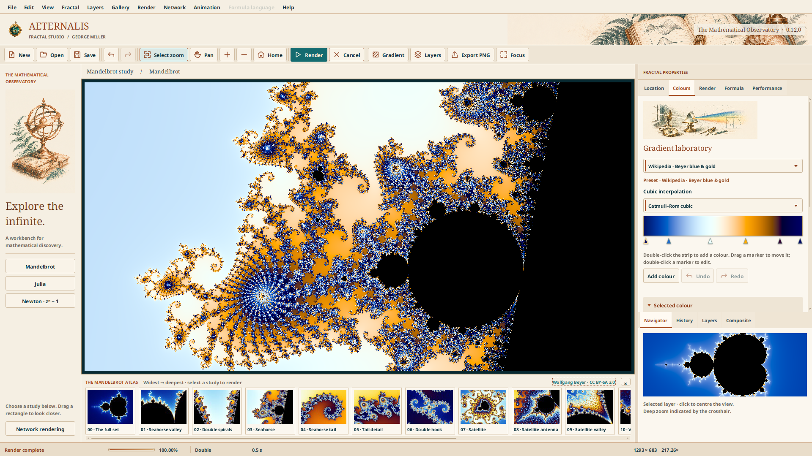

# Aeternalis Fractal Studio · 0.12.0

*An Infinite Canvas for Mathematical Discovery.*

A Java 21 / JavaFX fractal art workstation by George Miller for Code and Curiosity. This release adds automatic Double → Double-Double → Quad-Double → arbitrary precision, configurable CPU rendering, an optional validated OpenCL path, and a Victorian mathematical-observatory workspace. Independently editable layers, three formula families and reproducible JSON projects are preserved. This release adds integrated LAN Master–Worker rendering and disk-backed high-resolution PNG output. It is a source project for NetBeans/Maven, not a bundled Windows installer.

## New in 0.12 · The illustrated observatory

The main window now uses custom copperplate notebook/telescope, armillary-sphere and prism illustrations on the cream, copper and teal Jenga-Code theme. The illustration sidebar collapses below 1380 pixels; Focus hides both sidebar and atlas. Network, gradient and animation windows share the theme and existing app icon/window bounds.

The bottom **Mandelbrot atlas** contains Wolfgang Beyer's fifteen Wikipedia zoom-sequence images (00–14), ordered widest to deepest. Click any thumbnail to apply its exact published real centre, imaginary centre and horizontal diameter to the selected layer, select Mandelbrot and the cubic blue/gold palette, and start rendering. Other layers and the network session remain intact. Scroll horizontally for later studies. Click **×** on the atlas header to hide the whole section and reclaim the canvas space; **View → Mandelbrot atlas** brings it back. Focus temporarily hides it and respects your choice when you leave Focus. Right-click a card for its original file description and license, or click the credit link for the complete credits. The catalogue and thumbnails work offline.

Coordinates are decimal strings in `src/main/resources/com/jenga/aeternalis/zoom-gallery.xml`, parsed directly into `BigDecimal` and retained through project saving, navigation and network transmission. They are never first converted to double. This preserves the digits the author actually published; it cannot supply additional unpublished coordinate accuracy. The original images are 4:3; the viewport keeps your current aspect ratio and the exact horizontal diameter, so its vertical crop can differ. Iteration recommendations are Aeternalis settings, not claimed original author values. Images are freely licensed **CC BY-SA 3.0**, not public domain; see [full image credits and coordinate table](docs/WIKIMEDIA-CREDITS.md).

Type an iteration count directly in **Render → Iteration limit** (32–100000), then press Enter or Render. Invalid values are reported instead of silently using the previous count. Coordinates also accept long decimal strings and scientific notation. The new default blue/cyan/ivory/amber/purple gradient uses the RGB colours from Beyer's published UPR data, with Aeternalis Catmull–Rom cubic interpolation and its own colour mapping. It is a colour-scheme match, not a pixel-identical Ultra Fractal implementation. Existing saved projects retain their original palettes.



## Run

Install a full JDK 21 and Apache Maven 3.9+, then:

```sh
mvn clean test
mvn javafx:run
```

In NetBeans: **File → Open Project**, choose this folder containing `pom.xml`, select JDK 21, then **Run Maven → Goals → javafx:run**. `run-windows.bat` runs the same Maven command. First build downloads dependencies. No API key, Python, external encoder or copied JavaFX SDK is required.

## Try the new artwork tools

Open **Gallery → Copper & Nocturne · layered** for a ready-made Mandelbrot/Julia composition. Other Gallery entries demonstrate Newton basins for powers 3, 5 and 8. The same starter projects are provided in `examples/` for File → Open.

Click **Layers** in the toolbar to show the layer stack. The list is **top layer first**. Select a layer to edit its Location, Colours and Render properties. Each layer keeps its own viewport, formula, palette, iteration limit, quality, scan order and bailout.

- **Add** creates a new Mandelbrot layer; **Duplicate** copies the selected layer with a new identity.
- **Delete** removes the selected layer while preserving at least one layer.
- **↑ / ↓** raise and lower the layer.
- **Visible**, **Opacity** and **Blend** affect the composition without repeating complete cached orbits.
- Edit the layer name and press Enter to apply it.
- Enable **Transparent interior** in Colours to cut unescaped/non-converged samples out of that layer. Anti-aliased edge coverage contributes alpha, avoiding dark fringes.

Eight blend modes are implemented in linear light: Normal, Multiply, Screen, Overlay, Difference, Add, Lighten and Darken. Source-over alpha composition preserves transparency in PNG export. This is a fractal-layer stack, not yet a general image editor with groups or arbitrary masks.

## Formulas

| Family | Controls / interpretation |
|---|---|
| Mandelbrot | z starts at zero; z²+c; analytic interior and optional exact-cycle shortcuts |
| Julia | z starts at the pixel; editable complex constant; conservative escape bound for larger constants |
| Newton | Newton iteration for zⁿ−1, with n = 2–12; colours distinguish converged roots and convergence speed |

Changing family resets the selected layer to that family's sensible starting view. Other layers are unchanged. Julia fields and the Newton exponent appear only when relevant. Mandelbrot-only optimisations are never applied to other families. Formula language remains disabled. Animation now opens the resumable zoom film workshop.

## Save and reopen

Use **File → Save project** or **Ctrl+S** to write a `.aeternalis` file. **Ctrl+O** opens one. Project JSON stores all layer order, visibility, opacity, blend modes, formula parameters, exact decimal coordinates, numerical settings, gradient stops, interpolation and colour mappings. Rendered pixels and caches are recomputed as needed.

Saving uses a temporary file and atomic replacement where supported. Invalid/future-schema files are rejected before replacing the open document. New/Open/Close prompts to save unsaved work. There is no automatic recovery yet. Press Enter or use the appropriate Apply button to commit typed field edits before saving.

## Navigation

Drag a rectangle to zoom; its aspect ratio is locked to the image. Shift-drag, middle-drag or Pan mode moves the selected layer. Wheel/double-click zoom at the pointer. Escape cancels a selection, otherwise rendering. Ctrl+Z/Y undo/redo **viewport changes for the selected layer**; they are not general layer-edit undo. F11 toggles full screen; Focus hides the inspector. Navigator shows a separate selected-layer reference view with a viewport marker and click-to-centre navigation. Composite remains a separate tab. History is an in-session coordinate list.

## Colour and quality

Colours has editable 2–32-stop palettes, draggable markers, colour pickers, Catmull–Rom or cubic smoothstep interpolation, density/scale/offset controls, square-root/cube-root/logarithmic/power transfers, reverse, repeat/clamp, histogram mapping and interior colour. The separate **Gradient** window includes live RGB curve previews and docks back into the same state.

Custom `.aetpalette` files preserve stop positions, colours and cubic mode. Whole projects also preserve mapping and transparency settings. All formula families can use the same palette system; Newton provides a root/convergence index instead of an escape count.

Rendering uses physical display pixels. Draft calculates one sample per pixel, Clean four, Fine nine. Subpixel colours are averaged in linear light. Square previews refine 64 → 32 → 16 → 8 → 4 → 2 pixel blocks behind exact tiles; final exports contain only finished samples. Ten legacy scan patterns change scheduling/reveal order, not the completed numerical result. Classification telemetry distinguishes analytic interiors, finite double cycles, iteration limits and Newton convergence.

## Limits and next work

- Up to **8 layers**, **16 million samples per layer**, and **a heap-aware budget across visible layers**. The budget is at most 32 million samples and approximately 35% of maximum heap; image buffers and temporary previews require additional memory. On large/high-DPI displays, lower quality or hide layers if the app reports a budget limit.
- Complete numerical layers are cached independently from colour output. Palette, opacity, visibility and ordering edits can reuse cached data. Editing an unfinished layer may restart its numerical work; cache eviction can also require a later recalculation.
- Automatic starts in Double. Runtime HashMaps detect actual duplicate axis coordinates for distinct samples, discard that pass and retry in DD, QD, then arbitrary precision. There are no ULP or iteration-count promotion margins. Manual precision remains a minimum request. See the precision notes for numerical limits.
- Layer intermediates are 8-bit straight-alpha ARGB, blended in linear light. No 16-bit/HDR export is claimed.
- PNG exports the completed **visible viewport composition**. Independent-resolution general render queues, arbitrary formulas, orbit traps, distance-estimation colouring, image layers, opacity-stop curves, masks/groups, full document undo and autosave remain future work.

See [architecture](docs/ARCHITECTURE.md), [mathematics](docs/MATHEMATICS.md), [project format](docs/PROJECT-FORMAT.md), [legacy integration](docs/LEGACY-ALGORITHMS.md), [verification](docs/VERIFICATION.md), [roadmap](docs/ROADMAP.md), and [dependency notices](THIRD-PARTY-NOTICES.md).

MIT licence · George Miller, 2025–2026.

## Precision and hardware

Open **View → Performance & precision**, or the inspector Performance tab. Automatic workers start at one per available logical processor; manual counts allow comparisons. Choose CPU-only, Automatic, or GPU preferred with safe CPU fallback. Precision selection is a minimum request: collapsed coordinates are recalculated with a wider backend, never silently omitted. Decimal location fields preserve deep coordinates during navigation and project saves.

Mandelbrot deep views can use a high-precision reference orbit and double delta arithmetic, with uncertain samples recalculated at arbitrary precision. Other formulas use direct wide arithmetic. All antialiasing subpixels remain independent. The supported decimal input budget is 10,000 digits; this is not a guarantee of unlimited zoom or orbit accuracy.

OpenCL uses JOCL and requires a usable GPU driver, FP64, runtime validation and a measured advantage before Automatic selects it. Only Double Mandelbrot/Julia are GPU candidates. Vulkan, GPU double-double and GPU arbitrary precision are not implemented. JavaFX acceleration does not imply compute availability. No usable GPU was exposed on the validation host, so GPU execution and hybrid timings remain unverified there.

See [precision and hardware](docs/PRECISION-AND-HARDWARE.md), [actual CPU measurements](benchmarks/BENCHMARKS.md), and [verification](docs/VERIFICATION.md). Run `run-benchmarks.bat` to compare pools on your Windows computer. This is a complete source archive, not a bundled native installer.

## Resumable zoom films and GIFs

Open **Animation → Render zoom frames…** after navigating to your final view. Set starting horizontal span, span retention per frame (e.g. 0.9), output dimensions and fps. Create an empty output folder, then render PNGs one at a time. `zoom.xml` freezes the exact journey and complete layer/palette settings. Pause, close the program and reopen the XML to continue. Existing frames are checked and missing/damaged frames are rendered again.

The separate **Animation → Convert frame folder to video / GIF…** dialog converts a completed PNG folder into a looping GIF (built in) or H.264 MP4 for YouTube (uses the project-managed FFmpeg runtime). See [zoom animation instructions and limits](docs/ZOOM-ANIMATION.md). Example XML and a small real GIF/MP4 preview are included in `examples/Zoom-demo/` and `docs/`.

0.7.1 clarifies the animation workflow: create/open job → render PNGs → export. GIF/MP4 buttons unlock after a complete numbered sequence is found. Existing frame folders can be selected separately; empty/incomplete folders are caught before the Save dialog.

0.7.2 separates PNG sequence rendering from folder-to-video/GIF conversion. Secondary application windows stay within the main window and at most 90% of the current screen’s usable bounds; scrollable settings remain accessible on smaller windows. Native OS file/folder pickers are managed by the operating system.

## Website edition · 0.8

Normal startup displays the supplied Aeternalis illustration for three seconds with a smooth timed introduction bar, then opens the studio. Escape closes the introduction. The workspace and settings now use Jenga-Code’s cream paper, ink, copper and teal colours. Fractal palettes and saved projects are preserved.

0.8.1 places the three-second gold progress bar inside a solid black bottom strip in the revised opening artwork. The separate cream splash footer is removed.

## Integrated FFmpeg and formula selection · 0.9

FFmpeg is now a Maven dependency. NetBeans resolves the native runtime on the first build, and the app extracts/uses it automatically for MP4 export. No separate FFmpeg installation, PATH change or executable picker is required. Windows x64 is the default; supported Linux/macOS profiles select their native artifact. Network access is needed for the first dependency download; resolved dependencies are cached. See [FFmpeg integration](docs/FFMPEG.md).

Only Mandelbrot, Julia and Newton zⁿ−1 remain. Newton's exponent is editable from 2 through 12 in the Formula tab, including 4, 5, 6, 8 and 12 basins. Removed-family projects/jobs are rejected with an unsupported-formula message; this release does not silently convert them. Existing Mandelbrot/Julia/Newton projects and palettes remain supported. Gallery examples 3 and 4 now demonstrate Newton powers 5 and 8.

Every application Stage uses the same emblem, including animation windows, gradient editor, About/help/confirmation dialogs and custom colour-picker windows. Native file/folder pickers retain their OS-managed presentation and owner association.

0.9.1 improves long precision renders: preview passes publish partial snapshots, wide-precision final tiles are 16×16 rather than 64×64, and visible preview composition is refreshed at a roughly 0.75-second target cadence. Completed-tile percentage excludes previews; an expensive sample or reference orbit can still delay visible change.

## Collision-triggered precision · 0.10

Automatic now starts at Double and increases precision only after an actual coordinate collision (or an unrepresentable coordinate) during tile rendering. Per-axis HashMaps distinguish legitimate repeated x values across rows from distinct x positions rounded together; the same applies to y. This factors storage into O(width × grid + height × grid), rather than retaining every complex pixel in a huge map. Fully checked axis positions use cheap atomic flags on subsequent samples.

A collision cancels the old pass, clears its tiles/previews, and restarts the same layer at the next precision. GPU tiles pass through the same coordinate checks first. Only completed collision-free results enter caches or exports. The displayed precision follows the running backend. A new viewport starts its own check; completed identical requests can reuse their numerical cache. Manual minimum precision is still honoured. Coordinate uniqueness alone does not bound accumulated orbit error; the existing guarded perturbation path retains its numerical fallback checks.

0.10.1 shows render and cache percentages to two decimal places (0.67%, 100.00%) with a wider fixed-minimum progress label.

## LAN rendering · 0.11

Use **Network → Start Master Server** on one computer, and **Network → Connect as Worker** on the others. Set the same port/token and use the Master's LAN address. Each computer contributes its configured CPU threads. **Settings → DISTRIBUTED** forces network rendering; Automatic defaults to an estimated60s local-work threshold. Completed numerical tiles are coloured/composited on the Master and displayed progressively with two-decimal progress.

**Network → Render high-resolution PNG** supports independent resolutions with disk-backed numerical/ARGB tile storage and streamed PNG scanlines. The existing zoom-frame workflow also uses the session. Dynamic pull scheduling, bounded leases, heartbeats, reconnect/requeue, generation/assignment validation, global coordinate-collision precision restarts, computer statistics, a live chart and an optional ownership overlay are integrated.

Start with [NETWORK-README.md](NETWORK-README.md) for the LAN/firewall setup, [architecture](docs/NETWORK-ARCHITECTURE.md) for implementation details, and [actual multi-process loopback measurements](benchmarks/network/BENCHMARKS.md). Use only a trusted private LAN; do not expose the port publicly. Physical LAN/Windows network deployment remains to be verified on your computers.
